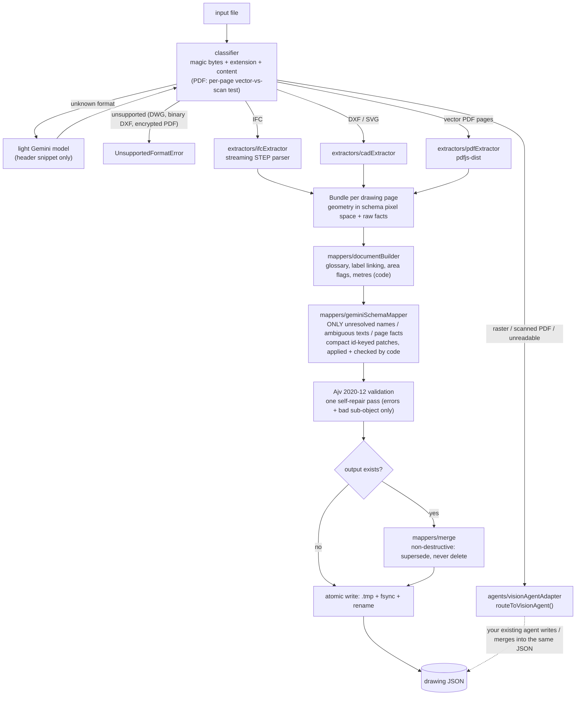

> Current public contract: **v0.3, one JSON per building**. [Full architecture and verification report](../docs/building-v0.3.md).

# blueprint-ingest

Entry-point **filter + vector extractor + Gemini schema mapper** for the Stoa blueprint pipeline (Node.js 22+, ESM).

It decides, per file, whether a drawing can be read **deterministically as vector data** (IFC, DXF, SVG, text-rich PDF) or must go to the **existing vision agent** (photos, scans, scanned PDFs). Vector sources produce **v0.3 building documents**, using `../translator/schema/building.v0.3.schema.json`. All source pages and IFC storeys are retained in one building; a multi-building IFC yields one output per building. Frozen v0.2 schemas and example files remain migration fixtures. Gemini only adds *semantics*, never geometry.

## Architecture



Why this shape (token cost + accuracy):

* **Geometry is never produced by an LLM.** Extractors write polygons in pixels; `*_m` fields, areas, volumes and area flags are computed by `storage/metres.js` from `drawing.scale.m_per_px`.
* **Zero Gemini calls when nothing is ambiguous.** A multilingual glossary (`mappers/glossary.js`, e.g. Finnish `MH` -> bedroom) resolves most room names; an IFC whose names are all known costs 0 tokens.
* **Gemini sees small, id-keyed requests**: unique unresolved labels (`{i, raw}`), up to 4 chunks of ambiguous texts per page, nothing else. Responses are schema-constrained and re-validated by code before being applied.
* **Scale comes from evidence**, in order `vector_units > scale_note > dimension_lines > door_width`. Written room areas only cross-check it (summary in `drawing.scale.note`).

## Setup

```bash
npm install                 # @google/genai, ajv, ajv-formats, pdfjs-dist (+ optional: file-type, web-ifc)
cp .env.example .env        # put GEMINI_API_KEY in it
npm test                    # node:test suite (the test/ folder was not part of the delivered zip)
```

Node >= 22 (on older Node the `.env` file is not auto-loaded: export the variables yourself). Without `GEMINI_API_KEY` everything deterministic still works; unresolved room names simply stay `type: "unknown"`.

## Usage

```bash
node src/index.js plan.ifc            --out out/plan.json
node src/index.js sheet.pdf           --out out/sheet.json     # multi-page: out/sheet.p1.json, out/sheet.p2.json ...
node src/index.js model.ifc --out out/building.json           # all levels, one building
node src/index.js photo.jpg                                    # -> routed_to_vision_agent (nothing written)
node src/index.js scan.pdf --file data/swiss_dwellings/scan.pdf --source swiss_dwellings  # set drawing.file / drawing.source explicitly
node src/index.js --validate-only out/plan.json
```

```js
import { processBlueprint } from './src/index.js';

const result = await processBlueprint({
  inputFilePath: 'plan.pdf',
  outputJsonPath: 'out/plan.json',
  mode: 'auto',        // auto: merge if file exists, else create | create: never touch an existing file | merge: file must exist
});
// result.status: 'processed' | 'processed_with_vision_routing' | 'routed_to_vision_agent'
```

Exit codes: `0` ok / routed, `1` error, `3` unsupported format.

### Building merge semantics

Source frames remain separate. IFC GlobalIds establish shared identity; page-local IDs are namespaced. Matching source observations are combined. Conflicting non-null facts fail with a useful entity/field error rather than overwriting either input. Existing v0.2 inputs are migrated centrally. The established v0.2 same-frame IoU/supersession merger remains available for internal compatibility; it does not compare pixels from unrelated building drawings.

See [the v0.3 architecture, migration and verification report](../docs/building-v0.3.md) for the complete contract and limitations.

## Internal page-fragment mapping (normalized into v0.3 before writing)

| Schema field | Filled from |
|---|---|
| `drawing.file` / `drawing.source` | `data/<source>/...` in the input path, else path relative to `DATASET_ROOT` (cwd); override with `--file` / `--source` |
| `drawing.route` | `ifc`, `dxf`, `svg`, `vector_pdf` (vision agent: `raster` / `vlm`) |
| `drawing.part` | IFC storey slug, or `p<n>` for multi-page PDFs (retained as source-frame metadata, never a storey output suffix) |
| `drawing.transforms` | model units -> page px (`affine`, DXF/IFC), pt -> px (`resize`, PDF), viewBox -> px (`resize`, SVG) |
| `levels[]` | IFC storeys (name, elevation, height when explicitly available, GlobalId); on PDFs/DXF/SVG the level name Gemini reads from the page |
| `units[]` | unit-label texts such as `Whg. A`, `Wohnung 3`, `Asunto B` (polygon unknown -> `null`) |
| `rooms[].type` / `is_outdoor` | glossary (EN/FI/ET/SV/DE/FR), then Gemini; how it was resolved is in `properties.name_resolution` |
| `rooms[].number` / `label` | IFC `Name` vs `LongName`, or a room-number text (`2.10`, `K08`, `3-1`) inside the room; label = `NAME (number)` |
| `rooms[].area_m2` | written area if present, else computed; >10 % mismatch adds flags `area_mismatch` + `check_this` |
| `objects[].category` | mapped onto `toilet / sink / shower / bathtub / sauna_bench / stair / other`; the source category stays in `subtype` |
| `openings[].kind` | `door`, `window`, `doorway` (opening without a leaf) |
| `provenance` | `extractor` = `vector_ifc` / `vector_dxf` / `vector_svg` / `vector_pdf` / `gemini_namer`; `source_ref` = GlobalId or extractor key; `layer` for DXF |
| `properties` | IFC psets/quantities, pixel-only values (`thickness_px`, `width_px`), text `value` / `font_size_px`, opening sill/head heights |
| `history[]` | one `extract` entry per run, `semantic_enrichment` (with `cost_usd`) when Gemini changed something, `merge` entries |

Not produced by the vector path (left empty for other extractors): `units[].polygon_px`, `rooms[].holes_px`, `walls[].room_ids`, `openings[].room_ids`, `edges` of kind `reference`.

## Extractors

| Format | What is read | Notes |
|---|---|---|
| **IFC** | Project/Storey/Space hierarchy, walls, doors, windows, columns, stairs, furniture, ... with GlobalIds; footprints from `IfcExtrudedAreaSolid` / profiles / FootPrint curves; wall axis; door-to-wall via `IfcRelVoidsElement` + `IfcRelFillsElement`; Pset `IsExternal`, quantities, materials | Own **streaming two-pass STEP parser** (no WASM, no full-file string). Tessellated geometry is never kept. `web-ifc` is an optional gap-filler for mesh-only elements (bounding boxes). One bundle per storey. |
| **DXF** | LINE, LWPOLYLINE, POLYLINE, CIRCLE, ARC, TEXT, MTEXT, INSERT (nested blocks), DIMENSION; units from `$INSUNITS` | Own dependency-free ASCII parser. Layer / block names -> wall, room, door, window, stair, object (EN/FI/DE/FR keywords). Unclassified layers are listed in `semantic`, not guessed. |
| **SVG** | polygon, polyline, rect, line, circle, path (M L H V C S Q T A Z), text, transforms | Own tiny XML reader (no entity expansion). Class / id names drive semantics (`class="Space Kitchen"`). Scale only from a printed note like `1:100`. |
| **PDF** | text runs with coordinates (merged per line), closed polygons -> room candidates (container outlines dropped), filled thin rectangles -> wall candidates, `1:100` scale note, vector/raster statistics | pdfjs-dist 6.x. Doors/windows/fixtures are **not** inferred from bare paths; coverage says `not_analysed` so the agent never claims "there is no door". Optional Files-API read of legend/schedule pages (upload is always deleted in `finally`). |

## Plugging in the existing vision agent

Everything non-vector ends in `src/agents/visionAgentAdapter.js`:

```js
routeToVisionAgent({ filePath, mimeType, detectionDetails, outputJsonPath, schemaPath })
// -> { status: 'routed_to_vision_agent', filePath, reason, outputJsonPath, agentInvoked }
```

`detectionDetails.reason` is e.g. `raster_image`, `scanned_pdf_no_vector_data`, `pdf_has_vector_and_scanned_pages` (then `detectionDetails.pages` lists the zero-based scanned pages).

Two ways to connect your agent:

1. **No code change:** set `VISION_AGENT_MODULE=./path/to/agent.js`. Its default export is called with the single argument object above; whatever it returns is passed back as `agentResult`. A throwing agent surfaces as `VISION_AGENT_FAILED`.
2. **In code:** edit `invokeAgent()` in the adapter (marked `PLUG-IN POINT`) and call your agent directly.

Contract for the agent: write a v0.3 building to the supplied staging `outputJsonPath` following `schemaPath`; the adapter validates before publishing. Use `drawings[]`, `source_documents[]`, `source_refs`, and `source_drawing_id`. Legacy v0.2 output is migrated. In each source drawing, set `drawing.route = "raster"` or `"vlm"`, give every entity `id` / `confidence` / `provenance: { extractor, source_ref }`, keep pixels of the original page image as source of truth, and if the file exists merge with `mergeDocuments()` from `src/mappers/merge.js` (supersede, never delete). Unchanged behaviour of this repo: it never builds that agent and never embeds the schema into data files.

## Gemini

* SDK: official `@google/genai`, key from `GEMINI_API_KEY`. Structured output via `responseMimeType: application/json` + `responseJsonSchema`.
* Tiers: `GEMINI_MODEL` (primary), `GEMINI_MODEL_HEAVY`, `GEMINI_MODEL_LIGHT` (used only to identify unknown file formats). Each tier walks `GEMINI_MODEL_FALLBACKS` when the API answers 404 / "model not found" and remembers the one that worked.
* Retries: exponential backoff with jitter on 429 / 5xx / network errors; unparsable JSON is asked once more.
* Usage: `result.usage` = calls, input/output tokens per model; set `GEMINI_PRICE_PER_M_INPUT/OUTPUT` to get `cost_usd` (also written to the `semantic_enrichment` entry in `history[]`).
* **Model IDs:** the defaults `gemini-4-hydrogen`, `gemini-4-carbon`, `gemini-3.8-flash` could not be confirmed in Google's public model documentation (which lists `gemini-3.6-flash` and `gemini-3.5-flash`). If your key cannot use them the fallback chain takes over automatically; set the variables explicitly once you know your IDs.

## Project layout

```
schema/blueprint.schema.json        frozen v0.2 migration contract; v0.3 lives in ../translator/schema/
src/index.js                        processBlueprint() + CLI
src/classifier/blueprintClassifier.js
src/extractors/{ifcExtractor,pdfExtractor,cadExtractor}.js  (+ ifc/stepParser.js, cad/dxfParser.js, cad/xml.js, pdfCommon.js, bundle.js, textRoles.js)
src/mappers/{geminiSchemaMapper,geminiClient,documentBuilder,merge,glossary}.js
src/storage/{jsonStore,metres}.js
src/agents/visionAgentAdapter.js
test/                               node:test, fixtures generated in code (no binary files)
```

## Known limits

* IFC: only plan footprints from vertical extrusions, FootPrint curves and mapped items are read analytically; curved/BREP-only elements need the optional `web-ifc` fallback (**not exercised by the tests**). Multi-layer walls are one polygon.
* DXF: polyline bulges (arcs) are ignored (counted in `semantic.unsupportedEntities`), HATCH/SPLINE are skipped; wall outlines without drawn thickness get an assumed 0.2 m at confidence 0.4 and a warning.
* SVG has no intrinsic real-world scale: without a `1:n` note `drawing.scale.m_per_px` is `null` and no metre value is reported. Arcs in paths are approximated by their end points.
* PDF: scale from a `1:n` note assumes the page is at true print size (confidence 0.6, warning attached); verify with a dimension.
* Binary DWG and binary DXF are rejected with a clear reason (convert to ASCII DXF or IFC).
* The live Gemini SDK path is covered by tests through an injected fake; it has not been run against the real API.
