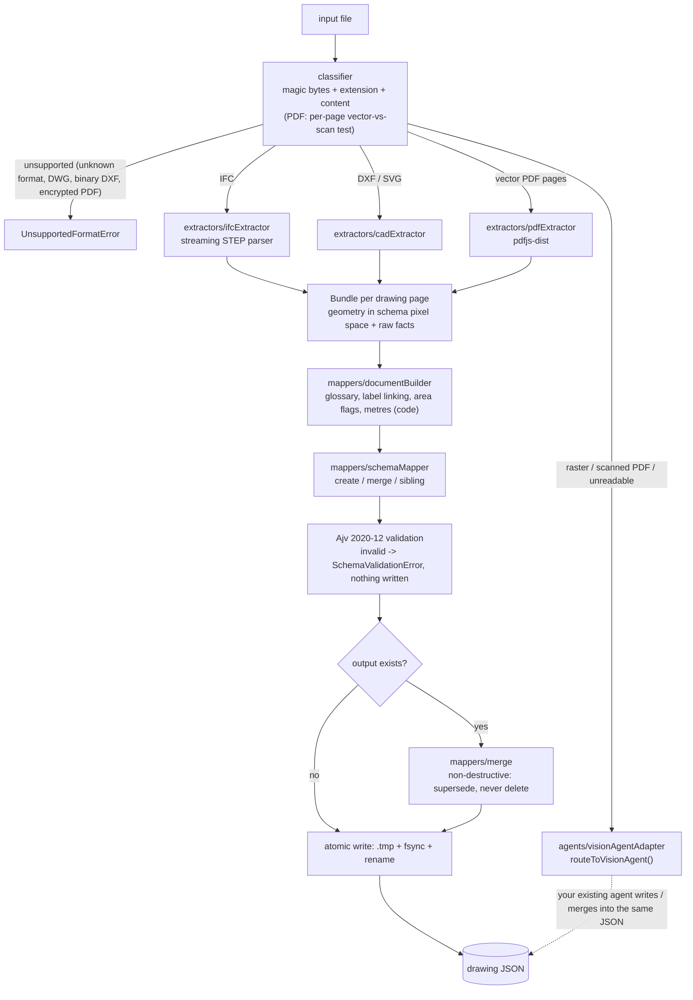

# blueprint-ingest

Entry-point **filter + vector extractor + schema mapper** for the Stoa blueprint pipeline (Node.js 22+, ESM). Fully deterministic and offline: no network calls, no model calls, same input -> same output.

It decides, per file, whether a drawing can be read **deterministically as vector data** (IFC, DXF, SVG, text-rich PDF) or must go to the **existing vision agent** (photos, scans, scanned PDFs). Vector sources are turned into the project's JSON schema **v0.2** (`schema/blueprint.schema.json`, one document per page or per IFC storey).

## Architecture



Why this shape:

* **Everything is code.** Extractors write polygons in pixels; `*_m` fields, areas, volumes and area flags are computed by `storage/metres.js` from `drawing.scale.m_per_px`.
* **Room names come from a multilingual glossary** (`src/mappers/glossary.js`, e.g. Finnish `MH` -> bedroom). Room names that are not in `src/mappers/glossary.js` stay type `"unknown"`, and text roles that cannot be decided by regex (`src/extractors/textRoles.js`) or by geometry (label inside a room) stay unknown (no `role` field).
* **Unknown file formats are not guessed**: they are `unsupported` with reason `unknown_format`.
* **Scale comes from evidence**, in order `vector_units > scale_note > dimension_lines > door_width`. Written room areas only cross-check it (summary in `drawing.scale.note`).

## Setup

```bash
npm install                 # ajv, ajv-formats, pdfjs-dist (+ optional: file-type, web-ifc)
npm test                    # node:test suite, no network
```

Node >= 22 (pdfjs-dist 6 needs it). Optional settings (`VISION_AGENT_MODULE`, `DATASET_ROOT`, `LOG_LEVEL`) are listed in `.env.example`; on Node 22 a `.env` file in the working directory is loaded automatically.

## Usage

```bash
node src/index.js plan.ifc            --out out/plan.json
node src/index.js sheet.pdf           --out out/sheet.json     # multi-page: out/sheet.p1.json, out/sheet.p2.json ...
node src/index.js model.ifc --levels "Level 1,Level 2"        # one JSON per storey
node src/index.js photo.jpg                                    # -> routed_to_vision_agent (nothing written)
node src/index.js scan.pdf --file data/swiss_dwellings/scan.pdf --source swiss_dwellings  # set drawing.file / drawing.source explicitly
node src/index.js --validate-only out/plan.json
```

```js
import { processBlueprint } from './src/index.js';

const result = await processBlueprint({
  inputFilePath: 'plan.pdf',
  outputJsonPath: 'out/plan.json',
  mode: 'auto',        // auto: merge if file exists, else create | create: never touch an existing file | merge: file must exist
});
// result.status: 'processed' | 'processed_with_vision_routing' | 'routed_to_vision_agent'
```

Exit codes: `0` ok / routed, `1` error, `3` unsupported format.

### Merge semantics (`mode: 'auto'` on an existing file)

* A better duplicate (same kind, bbox IoU >= 0.6, `confidence` higher by >= 0.15) **supersedes** the old entity (`status: "superseded"`, `superseded_by`); nothing is deleted. Otherwise the existing entity wins and only its **empty** fields are filled.
* Texts: same text at the same place = same text; a role upgrades a text that has none. Levels match by `name`, units by `label`.
* A stronger scale source replaces `drawing.scale` and all metre fields are recomputed.
* Coverage: the stronger claim wins per (category, region). The incoming `history` is appended plus one `merge` entry when something changed.
* **Pixel frames must match.** If the incoming page has another width/height, the default is to refuse (`FrameMismatchError`) because pixel coordinates are the source of truth. `--frame-mismatch sibling` writes `<name>.alt-WxH.json`; `reproject` rescales when the aspect ratio is identical.

## Schema v0.2 mapping

| Schema field | Filled from |
|---|---|
| `drawing.file` / `drawing.source` | `data/<source>/...` in the input path, else path relative to `DATASET_ROOT` (cwd); override with `--file` / `--source` |
| `drawing.route` | `ifc`, `dxf`, `svg`, `vector_pdf` (vision agent: `raster` / `vlm`) |
| `drawing.part` | IFC storey slug, or `p<n>` for multi-page PDFs (also the output file suffix) |
| `drawing.transforms` | model units -> page px (`affine`, DXF/IFC), pt -> px (`resize`, PDF), viewBox -> px (`resize`, SVG) |
| `levels[]` | IFC storeys (name, elevation, height to next storey, GlobalId); not detected on PDF/DXF/SVG pages (level-like texts get role `level_title`) |
| `units[]` | unit-label texts such as `Whg. A`, `Wohnung 3`, `Asunto B` (polygon unknown -> `null`) |
| `rooms[].type` / `is_outdoor` | glossary (EN/FI/ET/SV/DE/FR/IT, case- and accent-insensitive, trailing numbers stripped so "Chambre 2" resolves; "Pièce" / "Stanza" mean "room" and map to `other`), otherwise `unknown`; how it was resolved is in `properties.name_resolution`. A DXF room whose label did not resolve becomes `stair` when a stair flight is detected inside it (flag `inferred_from_contents`) |
| `rooms[].number` / `label` | IFC `Name` vs `LongName`, or a room-number text (`2.10`, `K08`, `3-1`) inside the room; label = `NAME (number)` |
| `rooms[].area_m2` | written area if present, else computed; >10 % mismatch adds flags `area_mismatch` + `check_this` |
| `objects[].category` | `toilet / sink / shower / bathtub / sauna_bench / stair / stove / fridge / washing_machine / elevator / radiator / other` (the last five added in 0.2.1, see below). DXF: from the block name, then the layer name (`src/extractors/fixtures.js`); the DXF block name is kept in `properties.source_block`. IFC/SVG/PDF: mapped from the source category; it stays in `subtype` |
| stair objects | `properties`: `tread_count`, `run_direction_deg` (plan frame: 0 = +x, 90 = +y down), `run_length_m`, `width_m`, `rise_direction` (`up`/`unknown`), `detected_by` (`layer`/`room_geometry`), `staircase_id` (one object per flight; flights of one staircase share it) |
| `flags` | `assumed_thickness` (wall line without a parallel partner, 0.2 m assumed), `inferred_from_room` (stair found from tread lines in a room named as a stair), `inferred_from_contents`, `area_mismatch` + `check_this` |
| `openings[].kind` | `door`, `window`, `doorway` (opening without a leaf) |
| `provenance` | `extractor` = `vector_ifc` / `vector_dxf` / `vector_svg` / `vector_pdf`; `source_ref` = GlobalId or extractor key; `layer` for DXF |
| `properties` | IFC psets/quantities, pixel-only values (`thickness_px`, `width_px`), text `value` / `font_size_px`, opening sill/head heights |
| `history[]` | one `extract` entry per run (`cost_usd: 0`), `merge` entries |

Not produced by the vector path (left empty for other extractors): `units[].polygon_px`, `rooms[].holes_px`, `walls[].room_ids`, `openings[].room_ids`, `edges` of kind `reference`.

## Extractors

| Format | What is read | Notes |
|---|---|---|
| **IFC** | Project/Storey/Space hierarchy, walls, doors, windows, columns, stairs, furniture, ... with GlobalIds; footprints from `IfcExtrudedAreaSolid` / profiles / FootPrint curves; wall axis; door-to-wall via `IfcRelVoidsElement` + `IfcRelFillsElement`; Pset `IsExternal`, quantities, materials | Own **streaming two-pass STEP parser** (no WASM, no full-file string). Tessellated geometry is never kept. `web-ifc` is an optional gap-filler for mesh-only elements (bounding boxes). One bundle per storey. |
| **DXF** | LINE, LWPOLYLINE, POLYLINE, CIRCLE, ARC, TEXT, MTEXT, INSERT (nested blocks), DIMENSION; units from `$INSUNITS` | Own dependency-free ASCII parser. Layer / block names -> wall, room, door, window, stair, object (EN/FI/DE/FR/IT keywords). Unclassified layers are listed in `semantic`, not guessed. **Walls by line pairing** (`src/extractors/dxfWalls.js`): parallel faces (< 3°, 0.05–0.60 m apart, ≥ 60 % overlap, the strip between them inside the outline) become one wall with the measured thickness; a face split by a junction pairs on its combined overlap; unpaired lines fall back to an assumed 0.2 m (confidence 0.4, flag `assumed_thickness`); end caps (also when split by a vertex) are dropped; collinear walls are merged, and bridged across a T/X junction when a third wall ends in the gap; **corners are mitred** (L) or cut to the through-wall face (T), so wall polygons meet without notches; assumed pieces that lie inside measured walls are dropped. **Stairs** (`src/extractors/stairs.js`): tread runs on stair layers, or tread lines inside rooms named as stairs; one object per staircase with `properties.flights[]` and inferred `landings[]` (a U stair is two flights 180° apart with a landing between). Each file logs `walls: N measured, M assumed, K merged, B bridged, J junctions closed`. |
| **SVG** | polygon, polyline, rect, line, circle, path (M L H V C S Q T A Z), text, transforms | Own tiny XML reader (no entity expansion). Class / id names drive semantics (`class="Space Kitchen"`). Scale only from a printed note like `1:100`. |
| **PDF** | text runs with coordinates (merged per line), closed polygons -> room candidates (container outlines dropped), filled thin rectangles -> wall candidates, `1:100` scale note, vector/raster statistics | pdfjs-dist 6.x. Doors/windows/fixtures are **not** inferred from bare paths; coverage says `not_analysed` so the agent never claims "there is no door". |

## Confidence policy (translator 0.2.1)

Written in `src/extractors/confidence.js` and applied by the DXF extractor: **0.9** class read from the file (layer / block name) and geometry measured, **0.7** geometry measured but class inferred (shape or context), **0.4** any dimension assumed. Every assumption also adds a reason to `flags`. The values are **caps**: an element keeps the lower of its previous confidence and the policy value, so a number only rises when its evidence did (e.g. a wall that was an assumed line, now measured by pairing: 0.4 -> 0.9). IFC, SVG and PDF keep their own values.

## Human corrections (`corrections.json`)

A deterministic lookup table (no model), read from `corrections.json` at the repo root (`CORRECTIONS_FILE` overrides; a missing file means none; a broken file or rule is logged and skipped):

```json
{ "ref:data/swiss_dwellings/x.dxf#obj60": { "category": "toilet" },
  "block:WC-01":    { "category": "toilet" },
  "room:Pièce":     { "type": "other" },
  "layer:WINDOW_2": { "as": "wall" },
  "layer:FIXTURE":  { "category": "sink" } }
```

`ref:` is one element of one drawing (`drawing.file` + `#` + `provenance.source_ref`), `block:` matches `properties.source_block`, `room:` a room's label or name, `layer:` with `as` re-reads a whole layer as another class (inside the extractor), with `category`/`kind`/`type` it changes every element on it. Matching is case- and accent-insensitive; each element takes the most specific rule (ref, block, room, layer). A corrected element gets `provenance.extractor: "human"`, confidence 1.0, the rule and the previous value in `provenance.details`, and `history[]` gets an `action: "correction"` entry naming the rule. Re-running into an existing file supersedes the uncorrected element. The viewer's "Correct" control writes this file.

## Schema additions in 0.2.1

Additive only, so `schema_version` stays `"0.2"` and every older file still validates: `objects[].category` also accepts `stove`, `fridge`, `washing_machine`, `elevator`, `radiator`. Stair data, `source_block` and the flags live in fields the schema already had (`properties`, `flags`). `drawing.translator_version` is `blueprint-ingest@0.2.1`.

A before/after run over `data/swiss_dwellings` and the IFC sets is in [`reports/classification-0.2.1.md`](reports/classification-0.2.1.md).

## Changes in 0.2.2

- **One vocabulary** (`src/mappers/vocabulary.js`). After extraction, every room type and object category is mapped onto the schema enums. Aliases are mapped (`living_room` → `living`, `hall` → `entry`, a generic `fixture` category with subtype `toilet` → `toilet`). Anything that does not map becomes `unknown` / `other`, keeps its raw value in `properties.raw_type` / `raw_category`, gets the flag `unmapped_vocabulary`, and is logged and recorded in `history`. blueprint-viewer copies the same file and applies it on load.
- **`closet` object category**, plus `placard|schrank|closet|wardrobe` in the DXF fixture rules (after the fridge rule, because *Kühlschrank* contains *schrank*).
- **IFC: web-ifc boxes were read in the wrong axes.** web-ifc returns Y-up geometry, and its bounding boxes were taken as plan x/y, which made them height slices. Mesh-only elements therefore landed far from their walls (esplanades: 44 of 101 doors and windows on a wall; ac20: 4 of 72) and had elevation-slice footprints. They are now converted back to Z-up: 101/101 and 72/72, and clinic sinks are 0.26 m² instead of 0.08. The georeference workaround from 0.2.1 was compensating for this bug and is removed.
- **IFC: non-vertical extrusions** (horizontal pipes, beams, walls swept along their length) are now read as their plan footprint: the hull of the profile at both ends of the sweep. Before, they were dropped. The clinic gains about 2 200 pipes, and the fantasy office 8 walls per storey.
- **IFC: one JSON per building.** All storeys of an `IfcBuilding` go into one document: every storey is an entry in `levels`, every element carries its storey's `level_id`, and all floors share one canvas and transform, so they share one coordinate system. With one building the output is exactly `--out`; with several, each file gets a suffix with the building's name. Room containment is checked per level.
- **IFC ids are injective.** GUIDs differing only in `$` versus `_` used to collapse into one id (7 pairs across the clinic levels). Now `_` is encoded as `_u` and `$` as `_d`, so `provenance.source_ref` still holds the raw GUID. GUIDs without either character keep their ids.

## Plugging in the existing vision agent

Everything non-vector ends in `src/agents/visionAgentAdapter.js`:

```js
routeToVisionAgent({ filePath, mimeType, detectionDetails, outputJsonPath, schemaPath })
// -> { status: 'routed_to_vision_agent', filePath, reason, outputJsonPath, agentInvoked }
```

`detectionDetails.reason` is e.g. `raster_image`, `scanned_pdf_no_vector_data`, `pdf_has_vector_and_scanned_pages` (then `detectionDetails.pages` lists the zero-based scanned pages).

Two ways to connect your agent:

1. **No code change:** set `VISION_AGENT_MODULE=./path/to/agent.js`. Its default export is called with the single argument object above; whatever it returns is passed back as `agentResult`. A throwing agent surfaces as `VISION_AGENT_FAILED`.
2. **In code:** edit `invokeAgent()` in the adapter (marked `PLUG-IN POINT`) and call your agent directly.

Contract for the agent: write (or merge into) `outputJsonPath` following `schemaPath` (schema v0.2), set `drawing.route = "raster"` or `"vlm"`, give every entity `id` / `confidence` / `provenance: { extractor, source_ref }`, keep pixels of the original page image as source of truth, and if the file exists merge with `mergeDocuments()` from `src/mappers/merge.js` (supersede, never delete). Unchanged behaviour of this repo: it never builds that agent and never embeds the schema into data files.

## Project layout

```
schema/blueprint.schema.json        the drawing schema v0.2, validated with Ajv 2020-12
src/index.js                        processBlueprint() + CLI
src/classifier/blueprintClassifier.js
src/extractors/{ifcExtractor,pdfExtractor,cadExtractor}.js  (+ ifc/stepParser.js, cad/dxfParser.js, cad/xml.js, pdfCommon.js, bundle.js, textRoles.js)
src/mappers/{schemaMapper,documentBuilder,merge,glossary,corrections}.js
src/extractors/{dxfWalls,stairs,fixtures,confidence}.js   wall pairing, stair flights, fixture names, confidence policy
src/storage/{jsonStore,metres}.js
src/agents/visionAgentAdapter.js
test/                               node:test, fixtures generated in code (no binary files)
```

## Known limits

* IFC: only plan footprints from vertical extrusions, FootPrint curves and mapped items are read analytically; curved/BREP-only elements need the optional `web-ifc` fallback (**not exercised by the tests**). Multi-layer walls are one polygon.
* DXF: polyline bulges (arcs) are ignored (counted in `semantic.unsupportedEntities`), HATCH/SPLINE are skipped. Wall faces with no parallel partner within 0.60 m (very thick walls) get an assumed 0.2 m (flag `assumed_thickness`). Gaps that are open in the drawn wall outline itself stay open. Swiss Dwellings: 81.5 % of walls have a measured thickness; wall ends 1 mm–25 cm short of another wall dropped from 5,289 to 828 over the 65 files.
* DXF stairs: only tread runs (≥ 4 even lines) are found; stair arrows are not read, so `rise_direction` is `unknown`. Landings are inferred between flights; plans carry no heights, so `at_height_m` is `null` and `after_tread` says how many treads lie below. When both ends of a U stair fit, the stair room decides (`side: "room"`), otherwise `side: "assumed"` and flag `landing_side_assumed`. Coverage says `partial` when stairs came from stair-named rooms only, `not_analysed` when nothing was found (never "no stairs").
* DXF fixtures: Swiss Dwellings fixtures are bare `FIXTURE` polylines with no block names, so they stay `other` until shape rules or a human correction classify them.
* IFC (fixed in 0.2.2): IfcSpace footprints given as a `FootPrint` `IfcGeometricCurveSet` are read (esplanades, molio and ac20 now have their rooms; esplanades `KORIDOR (119)` = 63.84 m², `ELUTUBA+KÖÖK (3-1)` = 25.25 m²), and web-ifc bounding boxes are converted from web-ifc's Y-up output back to IFC Z-up (they were read as x/height slices, which put esplanades' mesh-only elements 6,600 km from the rest and gave clinic fixtures elevation-slice footprints). The clinic plumbing model has no spaces, walls or doors at all.
* IFC: `IfcSpace` footprints come from FootPrint curves; spaces with only a Brep body and no footprint curve are still skipped (web-ifc does not mesh IfcSpace).
* DXF openings: Swiss floor 9385 has 7 door pairs and 2 window pairs with the same footprint (IoU ≈ 1, present since 0.2.0); they are counted twice. Check with `eval/score.py` before deduplicating.
* SVG has no intrinsic real-world scale: without a `1:n` note `drawing.scale.m_per_px` is `null` and no metre value is reported. Arcs in paths are approximated by their end points.
* PDF: scale from a `1:n` note assumes the page is at true print size (confidence 0.6, warning attached); verify with a dimension.
* Binary DWG and binary DXF are rejected with a clear reason (convert to ASCII DXF or IFC).
