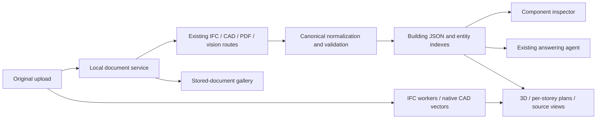

# BIM workspace architecture and verification

Implemented on `bim-workspace`, extending the existing `blueprint-viewer` and extraction/answering code.
The nine reference images extracted from `benchmarks.docx` informed the layout. No hosted demo,
new frontend framework, external image generation, or changes to the Scrollcraft landing were introduced.

## Run and review

Follow [blueprint-viewer/README.md](../blueprint-viewer/README.md) for installation and exact commands.
`npm start --prefix blueprint-viewer` launches the local Python service at http://127.0.0.1:4600.
A second checkout needs its own dependencies and local server; uploads are not committed to Git.

## Data flow and ownership

The canonical contract is `translator/schema/building.v0.3.schema.json`: `building_id`,
`source_documents`, `drawings`, `types`, `ifc_global_id`, source references and quantity arrays.
The two historical layouts both called 0.3 are distinguished by structure, not their version string.
Legacy 0.2 and the alternate drawing-based 0.3 cross an explicit validation/conversion boundary.
Unsupported alternate-layout fields are retained in a versioned source archive with identifier mappings.
The complete previous export is retained when a fresh IFC extraction upgrades a legacy output.
Conflicting independent building facts are not silently overwritten.

`indexBuilding` owns semantic lookups. The inspector and analysis read these validated facts.
`renderProjection` creates geometry-only views for the existing renderer; it does not become a second
semantic authority. Source files, extracted facts, render objects and session state remain separate.
An IFC source and its JSON use one document UUID scope plus the original IFC GlobalId. Reimporting
the same model creates a distinct document scope. DXF handles and SVG element IDs are kept separate
and linked to facts only when an explicit source identifier matches.

## Local service and storage

`workspace.server` uses Python's HTTP server, bound to loopback. `.workspace-data/<UUID>/` contains
an unchanged original, document metadata/checksum, validated building files, native previews and
analysis history. Atomic metadata writes protect job state. Uploads have a 256 MB limit.

| Endpoint | Behavior |
|---|---|
| `POST /api/documents` | Store bytes, create UUID, launch extraction job |
| `GET /api/documents` | Real stored-document metadata |
| `GET /api/documents/<id>` | UPLOADING / PROCESSING / READY / ERROR and results |
| `GET .../buildings` | Validated canonical building documents |
| `GET .../source` | Original uploaded bytes |
| `GET .../preview`, `.../thumbnail`, `.../source-info` | Generated source preview and CAD trace metadata |
| `GET .../analysis`, `POST .../analysis` | Stored answers; invoke the existing agent on selected building data |
| `DELETE /api/documents/<id>` | Cancel owned processing and delete that UUID's stored files |

IFC extraction uses the existing Python/IfcOpenShell route. JSON passes the Node compatibility
adapter. DXF/SVG/vector PDF reuse Node ingestion; DXF previewing reuses installed ezdxf, PDF
thumbnails reuse PyMuPDF. Missing vision configuration is reported as an extraction error while
the original document remains available. Removing a rendered file does not delete its library entry.

## Lifecycle defect and fixes

The original controller's `ensureViewer()` returned an existing renderer before restoring
`body.viewing`. Removing the last file cleared that class; the next upload built geometry in a
hidden stage. This was reproduced against the original controller in Chrome, and a real
494-mesh JSON import / clear / reimport was verified after the fix. No page reload is used.

The viewer now has EMPTY, UPLOADING, PROCESSING, READY, ERROR and REMOVING states with generation
ownership and AbortController cancellation. Clear invalidates queued work, terminates plan/parser
workers, drops caches and selection, disposes scene geometry/materials, and resets filters.
Late extraction and preview responses check session ownership before publication. A cleared
workspace keeps one reusable WebGL renderer, with its animation loop stopped; page teardown
also removes listeners and disposes controls, renderer and API resources.

Backend extraction runs out of process. Windows Job Objects own the Python parser and its Node
children; POSIX uses a process group. Cancellation terminates descendants, not just the parent.
A regression test proves that a cancelled descendant cannot perform a delayed file write.
Server startup marks interrupted jobs as errors rather than leaving them indefinitely processing.

Further integration fixes include bounded CSS grid rows (the canvas previously grew beyond the
visible viewport after panel changes), aspect-aware camera fitting, per-document floor identity,
source-preview cancellation, stale sidebar cleanup, empty-state restoration, preserving IFC
extrusion vectors, honoring `--schema 0.2`, and reconciling legacy IFC references without duplicate rooms.

## Rendering and interaction

- IFC parsing and BVH construction run in a worker using the existing web-ifc/Three.js stack.
  Meshes are batched; floor/category changes reuse geometry. Hidden element triangles are masked
  in the index buffer while original triangle identity is retained for selection/restoration.
- Every detected storey is available even if it has no geometry. Levels are scoped by source and
  IFC storey identity, with an explicit Unassigned group. Building names come from source data.
- Floor sections intersect actual mesh triangles at storey elevation plus configurable cut height.
  Cut edges and projected geometry have different line weights. Normalized room boundaries and
  labels supplement sections. Plans cache by source, storey and cut height; explode does not alter
  the source frame used for sections.
- Native Plan/FootPrint polylines, indexed straight segments, composite curves, circles and supported
  trimmed circle arcs are reused. Native-only products are retained separately from 3D meshes.
  Geometry absent from the source is not synthesized into plan symbols.
- Parallel mode has a draggable/keyboard-adjustable divider. Floor selection controls the plan and
  3D isolation. Selection/hover use identifier maps; selecting a represented element works both ways.
  Known entities without 3D geometry still have a semantic inspector fallback.
- DXF previews preserve curves, hatch paths, dimension/text rendering, block transforms and layers
  through ezdxf, with original handles and coordinates in the companion manifest. SVG vectors/groups
  retain their identity and transforms inside an isolated shadow root. Active/external SVG content
  is stripped; native group and source-entity-type filters remain distinct from storeys/categories.
- Component removal is reversible view state. Canonical measurements retain unknown versus zero,
  units, origins and provenance. Technical identifiers stay collapsed. Existing correction export,
  explode, separation, clipping and navigation controls remain available.

## Reference implementation

| Reference idea | Implemented behavior |
|---|---|
| Parallel drawing/model | Side-by-side views, divider, shared selection, floor plans |
| Professional 3D workspace | Dark model surface, neutral chrome, fit/reset/mode toolbar |
| Hierarchy and settings | Building/storey list, floor/category visibility, source layers, readable inspector |
| Source-linked technical review | Original/source plan beside real extracted counts, coverage, flags and agent answers |
| Drawing library | Actual stored files, generated/native thumbnails, building/floor metadata, open/delete/back |

The mobile layout uses a compact wrapping toolbar and overlay side panels. Source geometry and
controls remain usable at 390 x 844. Desktop states were visually inspected at 1500 x 950.

## Files and dependencies

| Files | Purpose |
|---|---|
| `workspace/server.py`, `extract.py`, `source_view.py`, `install.py` | Local API, owned extraction, previews and dependency bootstrap |
| `blueprint-viewer/workspace.js`, `session.js` | Workspace coordination and cancellable file sessions |
| `buildingModel.js`, `visibility.js` | Canonical lookup/projection and in-place visibility |
| `ifcGeometry.js`, `ifc.worker.js`, `ifcPlanRepresentations.js` | Real IFC meshes, worker parsing/BVH, native representations |
| `plans.js`, `plan.worker.js`, `planView.js`, `sourceView.js` | Sections, cache, interactive plans and native vectors |
| `inspector.js`, `analysis.js`, `library.js` | Facts, existing agent UI and stored-document gallery |
| `index.html`, `workspace.css`, `blueprintViewer.js` | Existing app integration, layout and renderer lifecycle |
| `scripts/start.mjs`, `vendor.mjs`, `check.mjs`, `browser-check.mjs`, `workspace-fixtures.py` | Local launch/assets and repeatable verification |
| `blueprint-ingest/src/schema/canonical.js`, mapper/storage/IFC changes | Explicit canonical boundary, preserved legacy behavior and extraction fixes |
| `answering_agent/agent.py`, `tools.py`, `translator/store.py` | Repair existing integration/conflict markers and canonical reads |
| Viewer tests, `tests/test_workspace.py`, ingestion tests | Lifecycle, geometry, provenance and canonical contract regression coverage |

No new runtime library was added. Existing web-ifc 0.0.68, Three 0.160.0 and BVH 0.7.8 remain pinned.
`playwright-core@1.55.0` is a development-only addition for repeatable Chrome checks; it uses installed
Chrome and does not download a browser. Existing declared dotenv/google-genai dependencies were
installed into the local virtual environment. Python formatting/import fixes also cleared baseline Ruff errors.

## Verification record ? 2026-11-15

Commands run from repository root:

| Command | Result |
|---|---|
| `.venv/Scripts/python -m pytest -q -p no:cacheprovider --tb=short` | 86 passed, 25 skipped |
| `.venv/Scripts/python -m ruff check .` | Passed |
| `npm --prefix blueprint-ingest test` | 51 passed, 1 skipped |
| `npm --prefix blueprint-viewer test` | 7 passed |
| `npm --prefix blueprint-viewer run check` | All application modules and inline controller parse |
| `npm --prefix blueprint-viewer start -- --port 4601` | Local service launched successfully |
| `npm --prefix blueprint-viewer run test:browser -- http://127.0.0.1:4601` | 18 core scenarios passed; no page errors |
| Same command with `--native-only` | Additional native-only IFC door arc / semantic inspection passed |

The suite now includes the additional native-only scenario by default. Its targeted run verified an actual
IFC FootPrint door arc (38 segments) through web-ifc and the semantic inspector. This caught and fixed
web-ifc mixed-case type names and string-valued numeric select handles.

The browser suite covers IFC plans for every fixture storey, combined floor/category filtering,
geometry/cache identity, both selection directions, inspection, explode, component remove/restore,
3D navigation, IFC?remove?IFC, IFC?remove?DXF, DXF?remove?SVG, SVG?remove?IFC, duplicate IFC imports,
DXF/SVG vectors/layers/interaction, SVG isolation, removal during extraction, recovery after an error,
stored-document opening, analysis-reference navigation, repeated cleanup, the large sample and mobile.

The committed Esplanades normalized sample produced **2,944 selectable entities / 3,515 meshes**.
A wall-group off/on operation took approximately **1.2 ms**, preserving geometry objects. This is a
measured visibility operation, not a claim of 60 FPS or a large real-IFC benchmark. After three
IFC import/clear cycles, renderer counters returned to the same baseline each time: 1 internal
geometry, 1 texture, 0 pick records, 0 cached plans, 0 plan workers. This checks bounded resource
counts over the tested cycles; it is not an exhaustive long-duration heap-leak proof.

Artifacts are generated in `.workspace-data/qa/`: browser-results.json, desktop/mobile screenshots
and test logs. The root package's old placeholder test is not the verification command; use the
package-specific commands above. This plain-JavaScript project has no TypeScript compiler or
frontend bundler to run.

## Limits and unverified areas

- The original clinic/Esplanades/Molio IFC datasets are absent. Their dataset-specific checks skip;
  the older viewer `verify.mjs` harness cannot run its full source-model suite here. The large-model
  check used the real committed normalized sample; source IFC checks used existing fixture builders.
- No GEMINI_API_KEY is configured. Deterministic answering tools, extracted review facts and citation
  navigation were tested; live model answers and external vision services were not verified.
- These are geometric sections/projections, not a full CAD hidden-line-removal engine. Occlusion of
  overlapping projected surfaces is not fully solved. Unsupported native splines/indexed three-point
  arcs and annotation constructs fall back to available mesh sections; absent symbols remain absent.
- Floor ownership follows IFC containment. More complex shared/cross-storey spatial-reference cases
  need original source-model validation; the tested cases cover independent storeys and Unassigned.
- Source DXF external images/fonts and unsupported CAD entities need their original assets. SVG
  external resources/active content are intentionally excluded from the interactive preview.
- JSON-only 3D retains the existing approximate extrusion behavior and its assumption banners.
  Its many individual meshes can be more expensive than batched real IFC. Heavy IFC parsing,
  BVH generation and mesh sections run in workers; legacy JSON scene assembly remains on the UI thread.
- The service is a local, single-user workspace, not an authenticated multi-user deployment.
